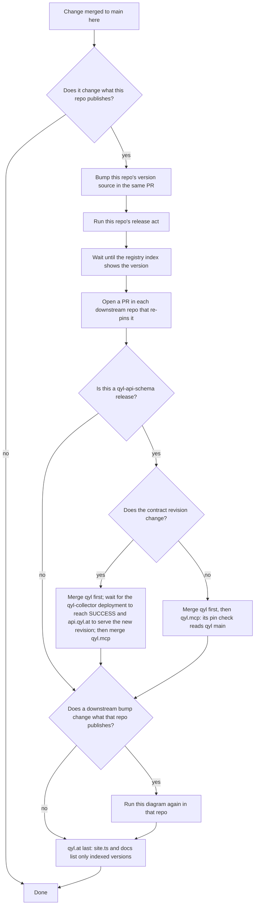

# qyl.mcp

qyl is observability built for AI agents. The MCP server lets a model measure,
correlate and diagnose a running system through compact, intent-driven tools
instead of raw log dumps. We want it to become the Swiss army knife of
connectors for agents. New capabilities are welcome, including tools that
change something, as long as they are honest about what they do, how they
are authorized, and stay inside qyl's own service.

Before you change a tool, the contract, or a doc in any qyl-dev repo, read
[the 2026-10-11 audit decisions](docs/decisions/2026-10-11-qyl-dev-audit.md):
they fix which write tools come next, in which order, and how each known
finding is resolved.

## How we review

- Look for concrete regressions: what triggers it, which path is affected and
  what the consequence is. A finding without those three parts is a question
  for the author, not a blocker.
- Judge a PR against the rules in this file and the requirements it touches,
  not against requirements we never adopted. When a rule should change, change
  it here in the same PR and say why.
- A clean Codex review plus the required CI checks is enough to merge.
  CodeRabbit is optional.
- Version bumps and deliberate requirement changes are normal work.

## What must stay true

These are the invariants the OpenAI and Anthropic directories and our users
rely on. Everything else is judgment.

### Accounts and projects stay separate

- Hosted operations authorize from validated credentials. Canonical resource,
  issuer, token audience, expiry and required scopes stay consistent with
  discovery and challenges.
- With account/project mapping enabled, access comes from the verified subject.
  Tool arguments, UI inputs and request metadata never select credentials or
  another project. Local/demo and single-project modes remain supported.

### Events behave

- Events are opt-in, scoped to the authenticated owner and Collector project,
  and re-authorized before delivery.
- Callback verification and signing, expiration, rotation, cancellation and
  unsubscribe keep working. Confirmed revocation stops delivery. An
  authorization outage pauses delivery without letting another subscriber
  advance its recovery baseline.
- Store only bounded subscription state. No OAuth tokens, no copied telemetry.

### Tools tell the truth

- Every tool has a `title` and annotations that match its behavior:
  `readOnlyHint: true` when it only reads, `destructiveHint: true` when it
  modifies or deletes. Both directories derive confirmation prompts from these
  hints, so they have to be accurate. Read-only is not a requirement; honesty is.
- Reading and writing are separate tools. A write tool states plainly what it
  changes, validates its input and never hides behind a generic executor.
  Separate create, update and delete where that matters.
- API ownership: every tool calls qyl's own APIs or APIs qyl legitimately
  proxies. Actions in third-party systems such as GitHub, Railway or cloud
  providers are not qyl tools. qyl diagnoses and proposes; the agent acts
  through its own connectors. Both directories reject unofficial third-party
  connectors.
- Descriptions state what the tool does and when to use it; both directories
  ask for both. Phrase the "when" as the user's need ("when the user wants to
  see the trace waterfall", "start here to find instrument names"), never as
  an order to the model ("the model should not call this"), and never as a
  restriction on other servers' tools. Hide app-only tools with
  `_meta.ui.visibility: ["app"]`.
- Responses stay proportional to the question: filters, limits and a way to
  leave out bulk data. Empty results and upstream errors are reported as such,
  never replaced with demo data.
- Stable tool names, structured results and generated Collector contracts.
  A snapshot update changes a contract and is reviewed as one.

### Viewers and data

- Viewer refresh keeps the original query, even when the host sends empty
  input. Version changed UI resources and keep the configured origin and CSP
  boundary.
- Telemetry and tool output are data, not instructions. Redact secrets in
  text, structured results, `_meta` and diagnostics.
- Collect only what a tool needs. qyl's own telemetry about incoming tool
  calls records only tool name, timing, status and error type. It must not
  persist argument values, `_meta` or conversation text, not even for
  logging.

## SDK v2 and protocol

- Use the official split SDK v2 packages. SDK major version and wire revision
  are independent: v2's built-in 2025-era support is required compatibility.
  Serving uses the SDK factory entries and their negotiation defaults. Era pins
  and rejection belong in focused tests and fixtures, not in production.
- Before suggesting an API replacement, check the installed v2 types and the
  [v2 migration guide](https://ts.sdk.modelcontextprotocol.io/v2/migration/support-2026-07-28).
  Keep SDK-managed request identity, error semantics and in-band
  `inputRequired` behavior. Self-reported client or server identity is never
  an authorization decision.
- Exact package versions may be upgraded. Adapters need not share the core
  package's version number.

## Verification that fits the diff

- `bun run verify:sdk` and lint enforce dependency and import rules. Existing
  tests cover authorization, Events, redaction, query restoration and tool
  manifests.
- `bun run smoke` for transport changes, `bun run smoke:otlp` for Collector
  contracts, `bun run smoke:projects` for account and Events isolation. Run
  what your diff touches; CI runs the combined gates.
- Don't weaken a gate or regenerate an expected result just to get green. If a
  gate is wrong, fix the gate and say so in the PR.
- A contract bump that changes the revision deploys in order: merge the
  Collector side, wait for its Railway deployment to reach `SUCCESS`, then merge
  here. The hosted server refuses a mismatched Collector and Railway stops the
  old container first, so the reverse order takes mcp.qyl.at down.
- For auth, outbound callbacks or storage changes, read
  [docs/threat-model.md](docs/threat-model.md).

## Release ripple across the qyl-dev repos

This section is identical in the `AGENTS.md` of all six qyl-dev repos (qyl-api-schema, Qyl.OpenTelemetry.SemanticConventions, Qyl.OpenTelemetry.AutoInstrumentation, qyl, qyl.mcp, qyl.at). Change it in all six in one sweep.

A merge or a release here is done only when the ripple is done: every downstream repo pins the new version on `main`, every downstream repo that had to re-release is published and indexed, and qyl.at lists only indexed versions.

When two producers feed one consumer (SemanticConventions and AutoInstrumentation both feed qyl), wait until both are indexed and re-pin them in one qyl PR.

Downstream edges: when a producer is indexed, the consumer re-pins it at these files in one PR.

| Producer (registry) | Consumer: files to re-pin |
|---|---|
| qyl-api-schema: `Qyl.Api.Contracts` (NuGet) and `@ancplua/qyl-api-schema` (npm) | qyl: `Version.props` `QylApiContractsVersion`, `services/qyl.dashboard/package.json`, `services/qyl.dashboard/bun.lock`, the `README.md` table. The collector compiles against this package and advertises its contract revision. |
| | qyl.mcp, after qyl's `main` carries it: `server/package.json`, `workbench/package.json`, `dashboard/package.json`, `bun.lock` |
| SemanticConventions: `Qyl.Telemetry.SemanticConventions`, `.Incubating`, `.Analyzers` (NuGet) | AutoInstrumentation: `Directory.Packages.props`, `SEMCONV_REF` in `live-check.yml`, `ref:` in `nuget-publish.yml` |
| | qyl: `Version.props` `QylSemanticConventionsVersion` |
| | qyl.at: `public/schemas/<version>` (served before the SemanticConventions tag is pushed) |
| AutoInstrumentation: `Qyl.Telemetry.Hosting`, `Qyl.Telemetry.AutoInstrumentation*` (NuGet) | qyl: `Version.props` `QylTelemetryVersion` |
| qyl: `qyl`, `qyl.<rid>` ×6, `Qyl.Api.Sdk` (NuGet); collector at `api.qyl.at` | qyl.mcp: its CI builds the collector from qyl `main`, and `mcp.qyl.at` refuses a collector with another contract revision |
| qyl.mcp: `qyl-mcp-server` (npm); server at `mcp.qyl.at` | qyl: the `qyl-mcp-server` row in `README.md`, which isn't rendered |
| every producer above | qyl.at: `src/data/site.ts` (the `release` list and the `headline` footer, one wave date), `src/content/docs/api-sdk.mdx`, `src/content/docs/getting-started.mdx` |

Release acts. The version source changes in the PR; the act runs after it merges.

| Repo | Version source | Release act | Index wait |
|---|---|---|---|
| qyl-api-schema | the tag only | `gh release create vX.Y.Z --target <sha> --title vX.Y.Z --notes …` | the workflow waits for npm and NuGet |
| SemanticConventions | `Directory.Build.props` `VersionPrefix`, `registry/manifest.yaml` `schema_url` and a `CHANGELOG.md` entry; then run `scripts/generate.sh`, which rejects a `schema_url` that differs from `VersionPrefix` | `git tag vX.Y.Z <sha> && git push origin vX.Y.Z` | the workflow requires `qyl.at/schemas/<version>` to be served, then verifies the published packages against nuget.org |
| AutoInstrumentation | `Directory.Build.props` `Version` | push tag `v<Version>` | the workflow waits for NuGet |
| qyl | `Version.props` `QylVersion`; bump it before the first package-affecting commit after a release | push tag `v<QylVersion>`; the workflow creates the GitHub release | the workflow waits for NuGet |
| qyl.mcp | `server/package.json` `version`, plus a `server/README.md` release-notes entry | `gh release create vX.Y.Z --target <sha> --title X.Y.Z --notes …` | the workflow smokes the published package with `npx` |
| qyl.at | none | merging to `main` deploys `qyl.at` | — |

Merging to `main` also deploys: qyl → `qyl-collector` (`api.qyl.at`, Railway), qyl.mcp → `qyl-mcp` (`mcp.qyl.at`, Railway), qyl.at → the `qyl-at` Worker (`qyl.at`, Cloudflare).

References: OpenAI
[MCP server](https://developers.openai.com/plugins/build/mcp-server),
[authentication](https://developers.openai.com/plugins/build/auth),
[Events](https://developers.openai.com/plugins/build/mcp-events),
[MCP UI](https://developers.openai.com/plugins/build/chatgpt-ui),
[plugin guidelines](https://developers.openai.com/plugins/plugin-guidelines).
Anthropic
[connector checklist](https://claude.com/docs/connectors/building/review-criteria),
[plugin checklist](https://claude.com/docs/plugins/pre-submission-checklist),
[directory policy](https://support.claude.com/en/articles/13145358-anthropic-software-directory-policy).
